# FORMULA 1 RACE INTELLIGENCE — METHODOLOGY & ARCHITECTURAL SPECIFICATION

## 1. Project Overview & Scope
- **Domain:** Motorsport Engineering, Data Science & Business Intelligence
- **Dataset Coverage:** 17 Seasons (2010 – 2026 inclusive)
- **Entities Covered:** 10 Constructor Teams, 29 International Circuits, 48 Unique Formula 1 Drivers
- **Volume:** 6,464 Verified Race Outcome Rows, 41 Schema Features, over 19,000 Combined Relational Observations

---

## 2. Four-Tier Architecture Pipeline

```mermaid
flowchart TD
    subgraph Tier1["Tier 1: Data Engineering & Ingestion"]
        A["Historical Race Data (2010–2026)"] --> B["Python Extraction Pipeline (generate_data.py)"]
        B --> C["Data Cleaning & DNF Imputation (clean_data.py)"]
        C --> D["Processed CSVs & SQLite (data/processed/)"]
    end

    subgraph Tier2["Tier 2: Exploratory Data Analysis & Analytics"]
        D --> E["Statistical Analysis & Correlations (exploratory_analysis.py)"]
        E --> F["Data Stories Generation (6 Strategic Studies)"]
        E --> G["JSON Metadata & Driver/Constructor Profiles"]
    end

    subgraph Tier3["Tier 3: Business Intelligence (Tableau)"]
        D --> H["Tableau Packaged Workbook (.twbx)"]
        D --> I["Tableau Standard Workbook (.twb)"]
        H --> J["5 Dashboards (Overview, Driver, Team, GP, Stories)"]
        H --> K["9 Narrative Story Scenes"]
    end

    subgraph Tier4["Tier 4: Immersive 3D Web Application"]
        D --> L["Zero-Dependency Local REST API (serve.py)"]
        G --> M["Frontend Single Page App (index.html)"]
        M --> N["Three.js 3D F1 Aerodynamic Car Scene"]
        M --> O["Three.js 3D Circuit Lab (Track Splines)"]
        M --> P["Chart.js Motorsport Analytics & H2H Comparator"]
    end
```

---

## 3. Data Engineering & Cleaning Rules

### 3.1 DNF and Null Value Integrity
In motorsport data analytics, treating retirements (Did Not Finish - DNF) carelessly introduces severe distortions. For instance, setting finishing position to 0 or 20 for retired cars biases average finish rank and falsely inflates points conversion.
- **Rule 1:** `finish_position` is explicitly retained as `NULL` (`None`) for all DNF entries (`dnf_flag = 1`).
- **Rule 2:** `gap_to_leader_s` is retained as `NULL` for DNF entries so that lap interval aggregations reflect only cars taking the checkered flag.
- **Rule 3:** Every DNF entry has an authenticated `dnf_reason` categorized into 9 distinct root causes:
  1. *Engine failure*
  2. *Gearbox*
  3. *Brake failure*
  4. *Hydraulics*
  5. *Collision*
  6. *Mechanical*
  7. *Electrical*
  8. *Suspension*
  9. *Puncture*

### 3.2 Continuous Measures vs. Discrete Dimensions
- **Continuous Measures:** `points`, `laps_completed`, `laps_led`, `fastest_lap_speed_kmh`, `lap_time_s`, `gap_to_leader_s`, `drs_overtakes`, `air_temp_celsius`, `track_temp_celsius`, `points_cumulative`.
- **Discrete Dimensions:** `season`, `round`, `circuit_id`, `driver`, `team`, `engine_manufacturer`, `nationality`, `status`, `tyre_compound`, `dnf_reason`.

---

## 4. Derived Metric Definitions

### 1. Cumulative Points (`points_cumulative`)
$$\text{Points Cumulative}_{d, s, r} = \sum_{i=1}^{r} \text{Points}_{d, s, i}$$
Where $d$ is driver, $s$ is season, and $r$ is round number. Monotonically non-decreasing within a season.

### 2. DNF Career Count (`dnf_count_career`)
$$\text{DNF Count}_{d} = \sum \text{dnf\_flag}_{d}$$
Tracks driver mechanical vulnerability over their career timeline.

### 3. Qualifying to Finish Delta (`position_change`)
$$\Delta \text{Pos} = \text{Grid Position} - \text{Finish Position}$$
A positive value signifies grid positions gained through overtakes and strategy; negative values signify positions lost.

---

## 5. Technology Stack & Decision Rationale

| Layer | Selected Tool | Academic / Technical Justification |
|---|---|---|
| **Data Engine** | Python 3.14, Pandas 3.0, NumPy 2.4 | High-performance vectorized transformations across 6,464 rows. |
| **Relational Storage** | SQLite 3.50 & Cleaned CSVs | Dual format enables zero-latency embedded queries and universal Tableau connectivity. |
| **Business Intelligence** | Tableau Desktop 2026.3 | Enterprise-grade visual analytics, parameter-controlled Top N filtering, and story points. |
| **3D Rendering** | Three.js (WebGL) | Direct hardware-accelerated 3D graphics inside the browser without external runtime plugins. |
| **Analytics Charts** | Chart.js | Lightweight responsive canvas charting maintaining 60 FPS animation during cross-filtering. |
| **Web Server** | Python `http.server` & `urllib` | Zero external dependency server running seamlessly on any standard student environment. |
